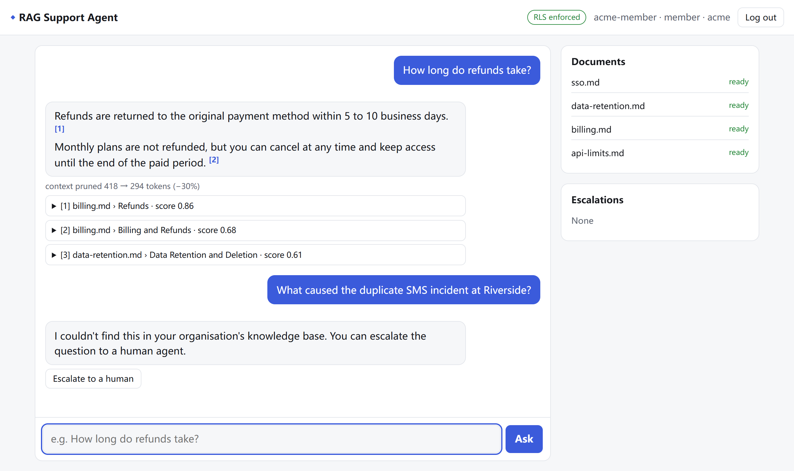

<div align="center">

# RAG Support Agent

**多租户 RAG 客服助手：由 PostgreSQL 本身保证，一个客户永远检索不到另一个客户的文档。**

[](https://github.com/yuhang-deng-cs/rag-support-agent/actions/workflows/ci.yml)
[](LICENSE)

[English](README.md) · 简体中文



</div>

## 为什么做这个项目

大多数多租户 RAG 示例靠应用代码里的一句 `WHERE tenant_id = ?` 来隔离客户。只要漏写一次过滤、
ORM 查询写错一次，或者一次被 prompt 注入的工具调用，向量检索就会把别的客户的数据交给 LLM。

本项目把租户隔离当成**数据库不变量**，而不是编码约定：

| 层 | 由什么保证 |
|---|---|
| 身份 | 租户只来自签名 JWT，且每次请求都与数据库中的用户记录核对；请求体里带 `tenant_id` 会直接被拒（422） |
| 应用 | 所有租户数据查询都在 `Database.tenant_session(tenant_id)` 中执行并按租户过滤 |
| 数据库 | PostgreSQL **行级安全（RLS）** + `FORCE ROW LEVEL SECURITY`：即使执行不带 `WHERE` 的 `SELECT *`，也看不到其他租户的行；没有设置租户 ⇒ 0 行（失败即关闭） |
| 表结构 | 复合外键保证切片不可能指向其他租户的文档 |

并且用**真实 PostgreSQL 上运行的攻击测试**证明这一点（CI 中执行）。

## 功能

- 🔒 Postgres RLS 强制租户隔离，测试会绕过应用层直接查库验证
- 🧪 攻击测试：`alg:none` JWT、错误密钥/篡改令牌、过期/停用用户、跨租户 ID、租户伪造、prompt 注入文档
- 🔎 pgvector 语义检索（HNSW 索引），本地开发可退化为 SQLite + NumPy
- 🧠 完全离线可运行：fastembed 本地 ONNX 向量 + 抽取式回答，无需 API Key
- 🔌 兼容任意 OpenAI 接口的大模型：OpenAI、DeepSeek、Ollama、vLLM……
- 📎 SSE 流式输出、带引用；检索置信度低时**拒答**并可转人工工单
- ✂️ 上下文裁剪，节省比例由评测脚本实测
- 👥 工作区 + 一次性邀请码加入
- 🚦 登录（按 IP + 用户名）与问答（按用户）**限流**，可用内存或 Redis 共享计数，超限返回 `429` + `Retry-After`
- 📄 列表接口**分页**（`limit` / `offset`，总数在 `X-Total-Count`），每个响应带 **`X-Request-ID`** 并写入访问日志
- 🧾 **审计日志**：注册、登录及失败登录、邀请、上传、删除、工单——按租户隔离，且在数据库层面**只能追加**（RLS 只允许 SELECT 与 INSERT）
- 🗄️ **Alembic 迁移**：启动时自动执行；模型改了却没写迁移时测试会失败；CI 在 SQLite 与 PostgreSQL 上验证升级与回退
- ⏱️ **压测数据可复现**：GitHub Actions 中基于 PostgreSQL + pgvector 运行 Locust 压测
- 🚀 一键部署演示：[](https://render.com/deploy?repo=https://github.com/yuhang-deng-cs/rag-support-agent)（详见 [docs/deploy.md](docs/deploy.md)）

## 快速开始

```bash
git clone https://github.com/yuhang-deng-cs/rag-support-agent.git
cd rag-support-agent
docker compose up --build
```

打开 <http://localhost:8000>，点击演示账号（密码 `demo-password`）：

- `acme-member`：问 *How long do refunds take?*，再问 *What caused the duplicate SMS incident at Riverside?*（这是 Umbra 的数据，必须查不到）
- `umbra-admin`：同样的 Riverside 问题可以正常回答

不用 Docker：

```bash
pip install -e ".[local]"
cp .env.example .env
uvicorn app.main:app --reload
```

接入大模型（以 DeepSeek 为例，在 `.env` 中）：

```bash
LLM_PROVIDER=openai
LLM_BASE_URL=https://api.deepseek.com/v1
LLM_MODEL=deepseek-chat
LLM_API_KEY=sk-...
```

## 评测结果

`python scripts/eval.py`（26 个问题：19 个可回答、4 个跨租户、3 个无关问题；bge-small-en-v1.5，阈值 0.6）：

| 指标 | 结果 |
|---|---|
| hit@k（可回答问题检索到正确文档） | **100%** |
| 跨租户泄露 | **0%** |
| 拒答率（跨租户 + 无关问题） | 71% |
| 裁剪后答案仍保留 | 95% |
| 裁剪节省的上下文 token | 37% |

未拒答的 29% 都是检索到了**本租户**的弱相关文档，从未出现其他租户的数据。`--sweep` 可查看不同阈值的权衡。
样本集较小，仅作回归基线。

更多细节（架构、API、安全模型、路线图）请见 [英文 README](README.md) 与 [docs/security.md](docs/security.md)。

## 性能

CI 压测（[工作流](.github/workflows/perf.yml)）：PostgreSQL 16 + pgvector，RLS 开启，租户内 **2 万+ 文本块**，
**20 个并发用户**，单个 uvicorn 进程，0 失败。共享 CI 机器性能有波动，两次结果都列出：

| 接口 | p50 | p95 | p99 | 吞吐 |
|---|---:|---:|---:|---:|
| `POST /search` —— [第 1 次](https://github.com/yuhang-deng-cs/rag-support-agent/actions/runs/45091973843) | 16 ms | **65 ms** | 130 ms | 45.8 次/秒 |
| `POST /search` —— [第 2 次](https://github.com/yuhang-deng-cs/rag-support-agent/actions/runs/45092369216) | 58 ms | **140 ms** | 230 ms | 39.5 次/秒 |

其中向量检索本身 p50 为 5–14 ms（p95 35–40 ms）。测试环境与复现方法见 [docs/performance.md](docs/performance.md)。

## 许可证

[MIT](LICENSE)
